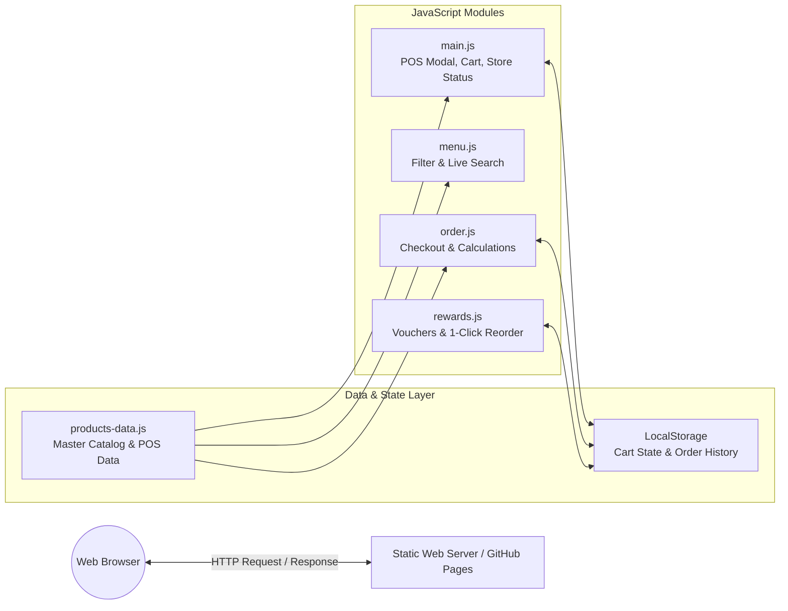

# MR.COFFEE


Aplikasi *landing page*, *company profile*, dan *online ordering catalog* untuk *artisan specialty coffee shop* modern. Dilengkapi dengan antarmuka interaktif, modal kustomisasi pesanan ala aplikasi kasir POS, sistem keranjang belanja dengan *LocalStorage*, status jam operasional *real-time*, hingga riwayat pesanan dengan fitur *1-click reorder*.

---

## Daftar Isi

- [Fitur Utama](#fitur-utama)
- [Tech Stack](#tech-stack)
- [Arsitektur Sistem](#arsitektur-sistem)
- [Struktur Folder](#struktur-folder)
- [Environment Variables](#environment-variables)
- [Instalasi & Penggunaan](#instalasi--penggunaan)
- [Catatan Pengelolaan](#catatan-pengelolaan)

---

## Fitur Utama

### ☕ Pengalaman Belanja & Katalog POS (Point of Sale)
- **Katalog Produk Terpusat (*Single Source of Truth*)**: Seluruh 13 varian menu dikelola secara terpusat di [`js/products-data.js`](js/products-data.js) lengkap dengan data profil rasa (*taste notes*), daerah asal (*origin*), serta tingkat sangrai (*roast level*).
- **Modal Kustomisasi Minuman Interaktif**:
  - Pilihan suhu penyajian: ☕ **Hot** / 🧊 **Iced**.
  - Pilihan tingkat kemanisan (*sugar level*): **100% Normal**, **50% Less Sugar**, atau **0% No Sugar**.
  - Pilihan susu (*milk substitution*): **Fresh Milk (Standar)** atau **Oat Milk (+Rp 8.000)** dengan kalkulasi harga subtotal otomatis.
  - Pilihan jumlah es (*ice level*): **Normal Ice** atau **Less Ice**.
  - Catatan instruksi khusus untuk barista.
- **Keranjang Belanja (*Cart Drawer*)**: Menyimpan pesanan secara instan ke `localStorage`, mendukung item dengan racikan kustomisasi berbeda, serta kontrol kuantitas dinamis.

### 🕒 Status Operasional Kafe Real-time
- **Live Store Status**: Indikator otomatis di navigasi bar membaca waktu lokal WIB (`Asia/Jakarta`):
  - 🟢 **Buka Sekarang** (Pukul 07.00 - 22.00 WIB) dengan animasi denyut visual.
  - 🔴 **Sedang Tutup** (Pukul 22.00 - 07.00 WIB).

### 🔁 Riwayat Pesanan & 1-Click Reorder
- Setiap pesanan yang diselesaikan di halaman checkout otomatis tersimpan ke riwayat pesanan lokal pengguna (*up to 5 recent orders*).
- Pengguna dapat melakukan **"Pesan Lagi 🔁"** dengan sekali klik, baik melalui kartu riwayat di halaman **Rewards** maupun banner di **Drawer Keranjang**.

### 🎨 Desain & Identitas Visual
- **Branding Tab Browser (Favicon)**: Favicon resmi multi-resolusi (`favicon.ico`, `favicon.png`, `favicon-apple.png`) berdesain *circular latte badge* yang kontras dan tajam pada tema gelap (*dark mode*) maupun terang.
- **Neumorphism & Glassmorphism UI**: Perpaduan bayangan ganda halus (*soft clay UI*), efek blur kaca, bentuk organik profil founder, dan transisi animasi *scroll-triggered* menggunakan `IntersectionObserver`.
- **Responsif Penuh**: Mendukung tampilan layar ponsel pintar, tablet, hingga monitor desktop lebar dengan *hamburger navigation menu*.
- **Aset Teroptimasi**: Kompresi gambar beresolusi tinggi hingga 95% untuk waktu muat (*load time*) super cepat tanpa penurunan kualitas visual.

---

## Tech Stack

| Komponen | Teknologi |
|---|---|
| **Frontend Core** | Semantic HTML5, CSS3 Modern (Custom Variables), Vanilla JavaScript (ES6+) |
| **Penyimpanan Lokal** | Browser `localStorage` (Cart state, order history, voucher persistence) |
| **Tipografi** | Google Fonts ([Playfair Display](https://fonts.google.com/specimen/Playfair+Display) & [Poppins](https://fonts.google.com/specimen/Poppins)) |
| **Tata Letak & Animasi** | CSS Flexbox, CSS Grid, CSS Transitions, Keyframe Animations, `IntersectionObserver API` |
| **Ikonografi & Favicon** | Aset PNG/ICO multi-resolusi lokal teroptimasi |

---

## 📸 Tampilan UI

<details>
<summary><b>Klik untuk melihat Screenshot Halaman UI</b></summary>

### 🏠 Home Page (Beranda)


### ☕ Our Menu (Katalog Menu Lengkap)


### 🎁 Rewards & App (Loyalty & Kupon Promo)


### 🛒 Place Order (Formulir Pemesanan & Struk Interaktif)


</details>

---

## Arsitektur Sistem

Arsitektur berfokus pada pengiriman aset statis (*Client-Side Rendering*) yang ringan tanpa ketergantungan server backend kompleks atau build tools tambahan:



---

## Struktur Folder

```
Coffee-Shop-Website/
├── favicon.ico           # Favicon multi-ukuran untuk browser tab
├── index.html            # Landing page utama & Most Ordered showcase
├── README.md             # Dokumentasi teknis proyek
├── css/
│   ├── style.css         # Desain utama, variabel warna, neumorphism, modal POS, badge jam buka
│   ├── responsive.css    # Media queries resolusi mobile & tablet
│   ├── about.css         # Styling khusus halaman Tentang Kami
│   ├── menu.css          # Styling katalog menu & filter chips
│   └── order.css         # Styling formulir pemesanan & nota struk
├── images/
│   ├── favicon.png       # Ikon web tab browser (64x64)
│   ├── favicon-apple.png # Ikon Apple Touch (192x192)
│   ├── logo copy.png     # Logo resmi MR.COFFEE (terkompresi)
│   ├── studentdiscount.png # Poster promo mahasiswa (terkompresi)
│   └── product*.jpeg     # Foto produk varian kopi artisan
├── js/
│   ├── products-data.js  # Master katalog produk, detail POS, origin, roast, & profil rasa
│   ├── main.js           # Engine cart, modal POS kustomisasi minuman, status operasional live
│   ├── menu.js           # Live search, filter kategori menu kopi
│   ├── order.js          # Kalkulasi harga, add-ons, voucher promo, & simpan riwayat order
│   └── rewards.js        # Salin kode voucher, redeem promo, & 1-click reorder
└── pages/
    ├── about.html        # Kisah founder, filosofi, & komitmen sangrai kopi
    ├── menu.html         # Katalog lengkap 13 varian kopi
    ├── order.html        # Halaman pemesanan online (Dine-in / Takeaway / Delivery)
    └── rewards.html      # Kartu keanggotaan loyalty, voucher, & riwayat pesanan
```

---

## Environment Variables

Proyek ini murni *Frontend Static Architecture* dan tidak terhubung ke API berbayar atau server eksternal, sehingga **tidak membutuhkan** berkas `.env`.

---

## Instalasi & Penggunaan

### Prasyarat
- Web Browser modern (*Google Chrome, Mozilla Firefox, Microsoft Edge, Safari*).

### Menjalankan di Komputer Lokal
```bash
# 1. Clone repositori
git clone https://github.com/NAxel-code/Coffee-Shop-Website.git

# 2. Masuk ke direktori proyek
cd Coffee-Shop-Website

# 3. Jalankan server lokal sederhana (misal menggunakan Python)
python -m http.server 8080
```
Buka browser dan akses alamat: `http://localhost:8080`.  
*Alternatif lain: Anda dapat menggunakan ekstensi **Live Server** di VS Code atau cukup klik ganda pada file `index.html`.*

---

## Catatan Pengelolaan

1. **Pembaruan Menu & Harga**:
   Untuk mengubah harga, deskripsi, atau menambah menu kopi baru, cukup sunting satu file di [`js/products-data.js`](js/products-data.js). Perubahan akan otomatis tersinkronisasi di halaman Home, Menu, hingga Order.
2. **Manajemen Cache**:
   Jika Anda melakukan pembaruan berkas CSS atau JS dan tampilannya belum berubah di browser, gunakan *hard refresh* (`Ctrl + F5` di Windows / `Cmd + Shift + R` di macOS).
