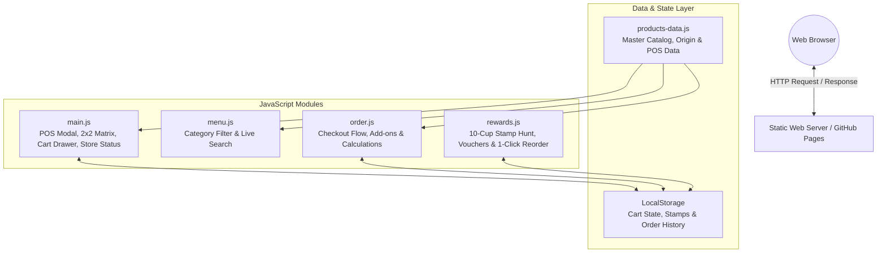

# MR.COFFEE


Aplikasi *landing page*, *company profile*, dan *online ordering catalog* untuk *artisan specialty coffee shop* modern. Menggabungkan estetika *Warm Latte Clay Neumorphism* dengan fungsionalitas aplikasi F&B kontemporer (terinspirasi dari *Chagee App* & *modern POS cashier*), fitur *10-Cup Stamp Hunt Gamification*, modal racikan kopi interaktif, status jam operasional *real-time*, hingga riwayat belanja dengan *1-click reorder*.

---

## Daftar Isi

- [Fitur Utama](#fitur-utama)
- [Tech Stack](#tech-stack)
- [Arsitektur Sistem](#arsitektur-sistem)
- [Struktur Folder](#struktur-folder)
- [Environment Variables](#environment-variables)
- [Instalasi & Penggunaan](#instalasi--penggunaan)
- [Catatan Pengelolaan](#catatan-pengelolaan)

---

## Fitur Utama

### ☕ Pengalaman Belanja & Modal Kustomisasi POS (Point of Sale)
- **Katalog Produk Terpusat (*Single Source of Truth*)**: Seluruh 13 varian menu dikelola secara modular di [`js/products-data.js`](js/products-data.js) lengkap dengan harga dasar, profil rasa (*taste notes*), daerah asal biji kopi (*origin*), serta rekomendasi penyajian.
- **Matrix 2x2 Size & Milk Substitution (Ala Chagee)**:
  - Pilihan kombinasi ukuran dan susu dalam kartu taktil interaktif:
    - ☕ **Regular Cup + Fresh Milk** (Harga Standar)
    - 🥛 **Regular Cup + Oat Milk** (+Rp 8.000)
    - 🥤 **Large Cup + Fresh Milk** (+Rp 5.000)
    - 🌱 **Large Cup + Oat Milk** (+Rp 13.000)
  - Kalkulasi harga dinamis dihitung langsung pada footer modal POS sebelum dimasukkan ke keranjang.
- **Kustomisasi Minuman Presisi**:
  - Pilihan temperatur: ☕ **Hot** / 🧊 **Iced**.
  - Pilihan tingkat kemanisan (*sugar level*): **100% Normal Sweet**, **50% Less Sugar**, atau **0% No Sugar**.
  - Pilihan jumlah es (*ice level*): **Normal Ice** atau **Less Ice**.
  - Kolom catatan khusus untuk instruksi barista.
- **Keranjang Belanja Dinamis (*Cart Drawer* & *Mobile Floating Pill*)**: Menyimpan pesanan secara instan ke `localStorage`, mendukung item dengan kustomisasi racikan berbeda, serta kontrol penambahan/pengurangan kuantitas.

### 🏆 Chagee-Style 10-Cup Loyalty Stamp Hunt
- **Pelacak Stempel Interaktif**: Kartu berburu 10 stempel cangkir kopi di halaman **Rewards** ([`pages/rewards.html`](pages/rewards.html)) dengan animasi stempel bertahap (*stamp animation*).
- **Progres Bar Transparan**: Menampilkan jumlah cangkir yang telah dikumpulkan menuju hadiah kopi gratis.
- **Klaim Voucher Otomatis**: Saat stempel ke-10 terkumpul, tombol klaim reward terbuka secara otomatis dan merilis kode voucher eksklusif `FREECOFFEE` (Gratis 1 cup signature drink di halaman checkout).

### 🕒 Status Operasional Kafe Real-time
- **Live Store Status**: Indikator otomatis di bar navigasi yang membaca waktu lokal WIB (`Asia/Jakarta`):
  - 🟢 **Buka Sekarang** (Pukul 07.00 - 22.00 WIB) dengan animasi denyut (*pulsing dot*).
  - 🔴 **Sedang Tutup** (Pukul 22.00 - 07.00 WIB).

### 🔁 Riwayat Pesanan & 1-Click Reorder
- Setiap pesanan yang berhasil diselesaikan di halaman checkout otomatis tersimpan ke riwayat pesanan lokal pengguna (*up to 5 recent orders*).
- Pengguna dapat melakukan **"Pesan Lagi 🔁"** dengan sekali klik, baik melalui kartu riwayat di halaman **Rewards** maupun banner di **Drawer Keranjang**.

### 📱 Disiplin Ergonomi & Mobile UI/UX First
- **Hirarki Tipografi Proporsional**: Ukuran judul dan teks pada smartphone (`<= 768px`) dipadatkan secara cermat (H1 `1.75rem`, H2 `1.35rem`, H3 `1.05rem`, Body `0.85rem`) sehingga konten tidak memakan lebih dari separuh tinggi layar.
- **Rasio Visual Kartu Modern**: Wadah gambar kartu produk ([`index.html`](index.html) & [`pages/menu.html`](pages/menu.html)) menggunakan tinggi rasio `145px` standar aplikasi F&B modern.
- **Navigasi Layar Sentuh Ergonomis**: Target sentuh (*tap target*) tombol dipertahankan minimal 42px-44px, hamburger menu taktil dengan bayangan neumorphic, serta filter kategori horizontal swipeable.
- **Anti-Zoom iOS Safari**: Seluruh input teks, dropdown, dan textarea menggunakan basis `16px` untuk mencegah gangguan pembesaran otomatis (*auto-zoom*) pada browser iPhone.

### 🎨 Desain & Identitas Visual
- **Branding Tab Browser (Favicon)**: Favicon resmi multi-resolusi (`favicon.ico`, `favicon.png`, `favicon-apple.png`) berdesain *circular latte badge* yang kontras dan tajam pada tema gelap (*dark mode*) maupun terang.
- **Neumorphism & Soft Clay UI**: Perpaduan bayangan ganda lembut (`var(--nm-flat)`, `var(--nm-inset)`), efek blur kaca (*glassmorphism*), dan transisi halus berbasis `IntersectionObserver`.

---

## Tech Stack

| Komponen | Teknologi |
|---|---|
| **Frontend Core** | Semantic HTML5, CSS3 Modern (Custom Variables), Vanilla JavaScript (ES6+) |
| **Penyimpanan Lokal** | Browser `localStorage` (Cart state, stamp hunt progress, order history, vouchers) |
| **Tipografi** | Google Fonts ([Playfair Display](https://fonts.google.com/specimen/Playfair+Display) & [Poppins](https://fonts.google.com/specimen/Poppins)) |
| **Tata Letak & Animasi** | CSS Flexbox, CSS Grid, CSS Transitions, Keyframe Animations, `IntersectionObserver API` |
| **Ikonografi & Favicon** | Aset PNG/ICO multi-resolusi lokal teroptimasi |

---

## 📸 Tampilan UI

<details>
<summary><b>Klik untuk melihat Screenshot Halaman UI</b></summary>

### 🏠 Home Page (Beranda)


### ☕ Our Menu (Katalog Menu Lengkap)


### 🎁 Rewards & App (Loyalty & Kupon Promo)


### 🛒 Place Order (Formulir Pemesanan & Struk Interaktif)


</details>

---

## Arsitektur Sistem

Arsitektur berfokus pada pengiriman aset statis (*Client-Side Rendering*) yang ringan tanpa ketergantungan server backend kompleks atau build tools tambahan:



---

## Struktur Folder

```
Coffee-Shop-Website/
├── favicon.ico           # Favicon multi-ukuran untuk browser tab
├── index.html            # Landing page utama & Most Ordered showcase
├── README.md             # Dokumentasi teknis proyek
├── css/
│   ├── style.css         # Desain utama, variabel warna, neumorphism, modal POS, badge jam buka
│   ├── responsive.css    # Utilitas motion-reduction & responsivitas tambahan
│   ├── about.css         # Styling khusus halaman Tentang Kami & Founder
│   ├── menu.css          # Styling katalog menu, filter chips, & modal detail
│   ├── order.css         # Styling formulir checkout, fulfillment picker, & struk
│   └── rewards.css       # Styling kartu loyalty, 10-cup stamp hunt, & kupon promo
├── images/
│   ├── favicon.png       # Ikon web tab browser (64x64)
│   ├── favicon-apple.png # Ikon Apple Touch (192x192)
│   ├── logo copy.png     # Logo resmi MR.COFFEE (terkompresi)
│   ├── banner.jpeg       # Foto hero stage roastery
│   ├── susantoliman.jpg  # Foto founder & CEO
│   └── product*.jpeg     # Foto produk varian kopi artisan teroptimasi
├── js/
│   ├── products-data.js  # Master katalog produk, detail POS, origin, roast, & profil rasa
│   ├── main.js           # Engine cart, modal POS kustomisasi minuman, status operasional live
│   ├── menu.js           # Live search, filter kategori menu kopi
│   ├── order.js          # Kalkulasi harga, add-ons, voucher promo, & simpan riwayat order
│   └── rewards.js        # Logika 10-Cup Stamp Hunt, klaim kupon FREECOFFEE, & 1-click reorder
└── pages/
    ├── about.html        # Kisah founder, filosofi, & komitmen sangrai kopi
    ├── menu.html         # Katalog lengkap 13 varian kopi dengan live filter
    ├── order.html        # Halaman pemesanan online (Dine-in / Takeaway / Delivery)
    └── rewards.html      # Kartu keanggotaan loyalty, 10-cup stamp hunt, & voucher promo
```

---

## Environment Variables

Proyek ini murni *Frontend Static Architecture* dan tidak terhubung ke API berbayar atau server eksternal, sehingga **tidak membutuhkan** berkas `.env`.

---

## Instalasi & Penggunaan

### Prasyarat
- Web Browser modern (*Google Chrome, Mozilla Firefox, Microsoft Edge, Safari*).

### Menjalankan di Komputer Lokal
```bash
# 1. Clone repositori
git clone https://github.com/NAxel-code/Coffee-Shop-Website.git

# 2. Masuk ke direktori proyek
cd Coffee-Shop-Website

# 3. Jalankan server lokal sederhana (misal menggunakan Python)
python -m http.server 8080
```
Buka browser dan akses alamat: `http://localhost:8080`.  
*Alternatif lain: Anda dapat menggunakan ekstensi **Live Server** di VS Code atau cukup klik ganda pada file `index.html`.*

---

## Catatan Pengelolaan

1. **Pembaruan Menu & Harga**:
   Untuk mengubah harga, deskripsi, atau menambah menu kopi baru, cukup sunting satu file di [`js/products-data.js`](js/products-data.js). Perubahan akan otomatis tersinkronisasi di halaman Home, Menu, hingga Order.
2. **Manajemen Cache**:
   Jika Anda melakukan pembaruan berkas CSS atau JS dan tampilannya belum berubah di browser, gunakan *hard refresh* (`Ctrl + F5` di Windows / `Cmd + Shift + R` di macOS).
